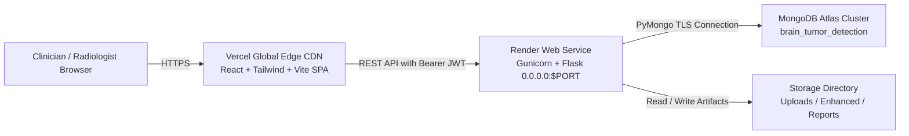

# BrainSight AI — Production Deployment Guide

This guide provides step-by-step instructions for deploying the **BrainSight AI** platform to production:
- **Frontend**: React + Vite on **Vercel**
- **Backend**: Python Flask + OpenCV + TensorFlow on **Render**
- **Database**: **MongoDB Atlas** (Cloud) with fallback **SQLite**

---

## 1. System Architecture



---

## 2. Pre-Deployment Verification Checklist

| Check | Item | Status | Details |
| :--- | :--- | :---: | :--- |
| **1** | Frontend & Backend Folders | **VERIFIED** | Clean separation (`frontend/` and `backend/`) |
| **2** | `package.json` & `requirements.txt` | **VERIFIED** | All production dependencies pinned |
| **3** | Flask Production Startup Command | **VERIFIED** | `gunicorn --workers 1 --threads 4 --timeout 120 --bind 0.0.0.0:$PORT app:app` |
| **4** | Port & `0.0.0.0` Binding | **VERIFIED** | `os.environ.get('PORT', 5000)` on `0.0.0.0` |
| **5** | Health Check Endpoint | **VERIFIED** | `GET /api/health` returns HTTP 200 with status JSON |
| **6** | Dynamic CORS Configuration | **VERIFIED** | Reads `FRONTEND_URL` to whitelist deployed Vercel domain |
| **7** | Centralized Frontend API Config | **VERIFIED** | Uses `VITE_API_BASE_URL` with relative proxy fallback |
| **8** | No Hardcoded Localhost in Frontend | **VERIFIED** | Zero `localhost` or `127.0.0.1` strings in `frontend/src` |
| **9** | Configurable Image Storage | **VERIFIED** | `STORAGE_DIR`, `UPLOADS_DIR`, `ENHANCED_DIR`, `REPORTS_DIR` |
| **10** | Configurable SQLite Path | **VERIFIED** | `SQLITE_DB_PATH` or `STORAGE_DIR/brain_tumor.db` |
| **11** | Trained Model Availability | **VERIFIED** | `brain_tumor_model.keras` (8.32 MB, fits Git < 100MB) |
| **12** | Production WSGI Server | **VERIFIED** | `gunicorn` configured with worker/thread memory constraints |
| **13** | Secrets & `.gitignore` Protection | **VERIFIED** | `.env`, `.db`, `node_modules`, `uploads` excluded from git |
| **14** | Vercel SPA Routing Configuration | **VERIFIED** | `frontend/vercel.json` rewrites all routes to `/index.html` |

---

## 3. Deployment Blockers & Engineering Solutions

### Blocker 1: TensorFlow RAM Consumption on Render Free Tier (512 MB)
- **Problem**: Loading TensorFlow alongside OpenCV can consume ~350 MB to 450 MB of RAM. If Gunicorn runs with standard multi-process workers (e.g. `workers=2` or `workers=4`), each worker forks a copy of the Python process and TensorFlow weights (~400 MB × 4 = 1.6 GB), immediately causing Render to kill the container with **`Exit Code 137 (OOM: Out Of Memory)`**.
- **Solution**:
  1. Set Gunicorn to run a **single worker process with lightweight threads**:
     ```bash
     gunicorn --workers 1 --threads 4 --timeout 120 --bind 0.0.0.0:$PORT app:app
     ```
  2. Restrict TensorFlow thread contention in environment variables:
     ```ini
     TF_ENABLE_ONEDNN_OPTS=0
     TF_NUM_INTEROP_THREADS=1
     TF_NUM_INTRAOP_THREADS=2
     ```
  3. The model is cached globally in memory only once upon first inference request (`services/prediction.py`).

### Blocker 2: Headless Linux Missing `libGL.so.1` (OpenCV)
- **Problem**: Standard `opencv-python` links against X11 OpenGL GUI shared libraries (`libGL.so.1`). On headless cloud Linux containers (Render, AWS, Docker), importing OpenCV throws:
  `ImportError: libGL.so.1: cannot open shared object file: No such file or directory`.
- **Solution**: Use `opencv-python-headless>=4.8.0` in `requirements.txt`. It contains identical image enhancement algorithms (CLAHE, bilateral filtering, sharpening) without requiring X11 desktop libraries.

### Blocker 3: Ephemeral File Storage vs. Persistent Disks
- **Problem**: Render web services use ephemeral storage: restarting or sleeping the container wipes all newly uploaded MRI images and local SQLite database files.
- **Solution**:
  - **Database Persistence**: Use **MongoDB Atlas** for database persistence via `MONGODB_URI`.
  - **File Storage**: Set `STORAGE_DIR` to a mounted Render Persistent Disk (e.g., `/var/data`), which automatically redirects `uploads/`, `enhanced_images/`, `reports/`, and SQLite fallback data to persistent disk storage.

### Blocker 4: Model Size & GitHub File Limits
- **Problem**: GitHub rejects files larger than 100 MB unless Git LFS is configured.
- **Solution**: The trained CNN model (`brain_tumor_model.keras`) is **8.32 MB**, well below GitHub's 100 MB limit. It can be committed directly to Git. Additionally, `services/prediction.py` supports `MODEL_DOWNLOAD_URL` to automatically download weights if missing.

---

## 4. Deploying Backend to Render

### Option A: 1-Click Blueprint Deploy (Recommended)
1. Push your repository to GitHub.
2. In the [Render Dashboard](https://dashboard.render.com/), click **New** → **Blueprint**.
3. Select your repository. Render will automatically detect [`render.yaml`](file:///c:/Users/avadh/OneDrive/Desktop/PROJECT/brain-tumor-detection/render.yaml) and configure all build and start commands.

### Option B: Manual Web Service Setup
1. In the [Render Dashboard](https://dashboard.render.com/), click **New** → **Web Service**.
2. Connect your GitHub repository.
3. Configure the following settings:
   - **Name**: `brainsight-ai-backend`
   - **Region**: Oregon or Frankfurt (choose nearest to users)
   - **Branch**: `main`
   - **Root Directory**: `backend`
   - **Runtime**: `Python 3`
   - **Build Command**:
     ```bash
     pip install --upgrade pip && pip install -r requirements.txt
     ```
   - **Start Command**:
     ```bash
     gunicorn --workers 1 --threads 4 --timeout 120 --bind 0.0.0.0:$PORT app:app
     ```
   - **Health Check Path**: `/api/health`

4. Add the following **Environment Variables**:

| Variable | Value / Description |
| :--- | :--- |
| `PYTHON_VERSION` | `3.10.13` |
| `FLASK_DEBUG` | `false` |
| `FRONTEND_URL` | `https://your-app-name.vercel.app` (your Vercel frontend URL) |
| `MONGODB_URI` | `mongodb+srv://<user>:<password>@cluster0.mongodb.net/?retryWrites=true&w=majority` |
| `MONGODB_DB_NAME` | `brain_tumor_detection` |
| `JWT_SECRET_KEY` | *(Click "Generate" in Render or use a 32+ character random string)* |
| `TF_ENABLE_ONEDNN_OPTS` | `0` |
| `TF_NUM_INTEROP_THREADS` | `1` |
| `TF_NUM_INTRAOP_THREADS` | `2` |

5. Click **Create Web Service**. Once deployed, copy your backend URL:
   `https://brainsight-ai-backend.onrender.com`

---

## 5. Deploying Frontend to Vercel

1. In the [Vercel Dashboard](https://vercel.com/dashboard), click **Add New...** → **Project**.
2. Import your GitHub repository.
3. In the project configuration:
   - **Framework Preset**: `Vite`
   - **Root Directory**: Click "Edit" and select `frontend`
   - **Build Command**: `npm run build`
   - **Output Directory**: `dist`
4. Expand **Environment Variables** and add:

| Key | Value |
| :--- | :--- |
| `VITE_API_BASE_URL` | `https://brainsight-ai-backend.onrender.com` *(your Render backend URL with no trailing slash)* |

5. Click **Deploy**.
6. Once deployed, note your Vercel URL (e.g., `https://brainsight-ai.vercel.app`).
7. Return to your Render backend dashboard and add your Vercel URL to the `FRONTEND_URL` environment variable.

---

## 6. Post-Deployment Verification

After both services are deployed, test the following endpoints in your browser or terminal:

### 1. Test Backend Health Endpoint
```bash
curl https://brainsight-ai-backend.onrender.com/api/health
```
**Expected Response (HTTP 200)**:
```json
{
  "message": "Backend is running",
  "service": "BrainSight AI Backend",
  "status": "success"
}
```

### 2. Test Model Availability
```bash
curl https://brainsight-ai-backend.onrender.com/api/model/status
```
**Expected Response (HTTP 200)**:
```json
{
  "classes": ["Glioma", "Meningioma", "No Tumor", "Pituitary Tumor"],
  "model_available": true
}
```

### 3. Test MongoDB Database Status
```bash
curl https://brainsight-ai-backend.onrender.com/api/database/status
```

### 4. Test Frontend
Open your Vercel domain (`https://brainsight-ai.vercel.app`):
1. The header should display **API ONLINE** and **CNN ONLINE** in emerald green.
2. Ingest an MRI scan (or select a preset).
3. Verify OpenCV Enhancement, CNN Inference, Grad-CAM visualization, and PDF download work seamlessly in production.
